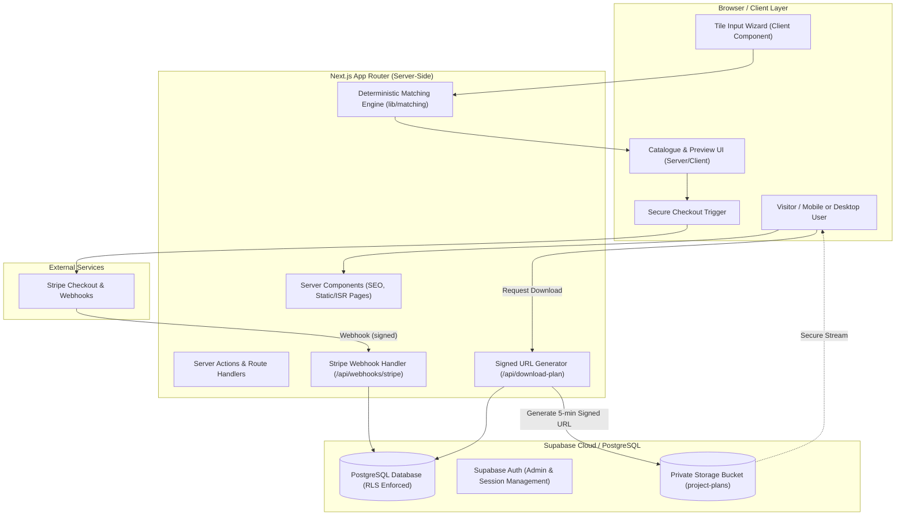
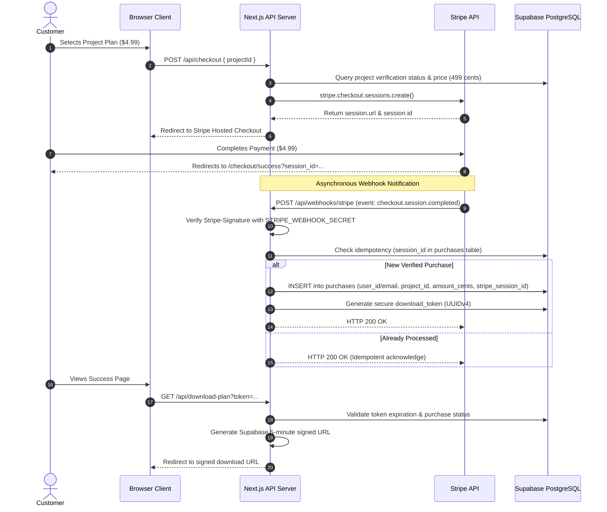

# Leftover Tile Project Planner — System Architecture Document

## 1. Architectural Overview & System Topology

The application follows the **Next.js App Router** architectural model, hosted on Vercel or modern Node.js runtimes, paired with Supabase as the backend database, authentication provider, and asset storage engine.

---

## 2. Component Layering & Server/Client Boundary Strategy

To ensure optimal performance, SEO indexing, and robust security, components are strictly divided based on their functional requirements:

### 2.1 Server Components (Default)
- **Use Cases**:
  - Landing page marketing content, sample project grids, and static value propositions.
  - Project detail pages (`/projects/[slug]`) to enable full search engine crawling and JSON-LD structured data emission.
  - SEO DIY guides and articles (`/articles/[slug]`).
  - Layout wrappers (`Header`, `Footer`, container layouts).
- **Benefits**: Zero client bundle footprint for editorial text, direct secure database queries without exposing API tokens, instant Time-to-First-Byte (TTFB).

### 2.2 Client Components (`"use client"`)
- **Use Cases**:
  - Interactive forms: Tile dimension calculator (`src/components/calculator/*`).
  - Interactive UI controls: Accordion toggles, responsive mobile navigation drawers, filter tabs.
  - Payment initiation buttons interacting with Stripe Elements or redirect handlers.
- **Rules**:
  - Push `"use client"` directives as far down the component tree as possible (leaf nodes).
  - Never import server-only utilities (`lib/supabase/admin.ts`, `STRIPE_SECRET_KEY`) into Client Components.

---

## 3. Deterministic Tile-Matching Engine Design

### 3.1 Guiding Principles
- **Zero AI Hallucination**: AI must **never** invent dimensions, cut counts, structural requirements, or tool safety recommendations.
- **Pure Mathematical Rigor**: Computations are deterministic functions of input geometry, material hardness, and project constraints.

### 3.2 Matching Formula & Algorithm Flow
1. **Input Normalization**:
   - Standardize user dimensions to millimeters internally:
     $$\text{Length}_{\text{mm}}, \quad \text{Width}_{\text{mm}}, \quad \text{Thickness}_{\text{mm}}$$
   - Convert user quantity $Q$ into gross usable surface area:
     $$A_{\text{gross}} = Q \times (\text{Length}_{\text{mm}} \times \text{Width}_{\text{mm}})$$
2. **Waste & Cutting Factor**:
   - Depending on tile condition:
     - **Intact tiles**: Net usable area $A_{\text{net}} = A_{\text{gross}} \times 0.90$ (accounts for standard 10% kerf and trim waste).
     - **Broken / Shards**: Net usable area $A_{\text{net}} = A_{\text{gross}} \times 0.75$ (accounts for 25% mosaic fracture waste).
3. **Project Suitability Classification**:
   - **Tier 1: Exact Fit (No Tile Cutting Required)**:
     - Project module is an integer multiple of user tile size + standard grout line ($2-3\text{mm}$).
     - $Q \ge Q_{\text{required}}$.
   - **Tier 2: Modular Trimming (Straight Cuts Only)**:
     - User tile size exceeds project piece dimensions; wet saw or snap cutter can section tiles into required modular units.
     - $A_{\text{net}} \ge A_{\text{project\_required}}$.
   - **Tier 3: Mosaic / Broken Shard Projects**:
     - Any tile condition permitted (including broken fragments).
     - Total shard area meets minimum fill requirements for substrate (trivet, tray, mosaic planter).
4. **Material Compatibility Filter**:
   - Outdoor projects (garden steps, birdbaths) require porcelain or frost-resistant quarry tile. Ceramic wall tiles are excluded from freeze-thaw applications.
   - Wet areas (shower niche, coaster surfaces) enforce waterproof grout and non-porous tile requirements.

---

## 4. Stripe Checkout & Webhook Lifecycle

### 4.1 Security Invariants
- Browser redirect pages are **never** trusted as proof of payment.
- The `purchases` record is created strictly via the verified Stripe webhook.
- All amounts are handled strictly as integer cents (`499`).

---

## 5. PDF Generation & Secure Distribution Architecture

Printable project plans are the core monetization asset. Their security and visual precision are paramount:
- **Storage**: Project plan PDFs are stored in a private Supabase Storage bucket (`project-plans`).
- **No Public Read**: Bucket permissions prevent public read access. Only service-role operations or authenticated signed URL generators can generate signed URLs.
- **Signed URL Window**: Download links expire strictly within 300 seconds (5 minutes).
- **Personalized Watermarking (Phase 4)**: Downloaded PDFs embed the purchaser's unique receipt ID and timestamp in the footer to discourage unauthorized online redistribution.

---

## 6. Internationalization (i18n) & SEO Strategy

- **Locales Supported**:
  - `en` (English - default)
  - `de` (German)
  - `fr` (French)
  - `es` (Spanish)
- **URL Routing Strategy**:
  - Clean URL prefixing: `/{locale}/projects/[slug]`, `/{locale}/articles/[slug]`.
  - Canonical link tags `<link rel="canonical" href="..." />` pointing to the canonical version.
  - Bidirectional `hreflang` tags across all 4 locales.
- **Schema.org Structured Data**:
  - `HowTo` schema on project preview pages (steps, tools, materials, estimated cost).
  - `Article` schema on editorial DIY guides.
  - `Product` and `Offer` schema on paid downloadable plans ($4.99 USD).
