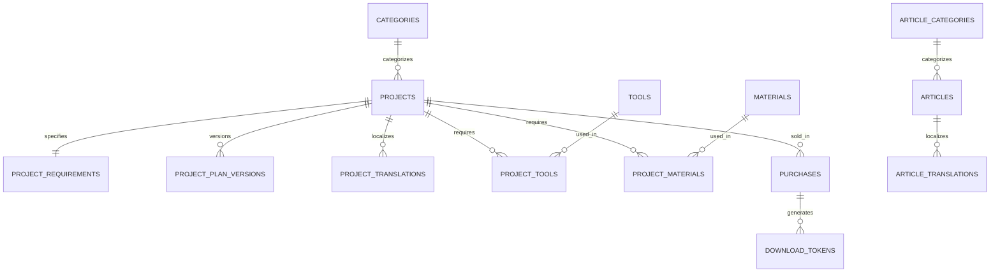

# Leftover Tile Project Planner — Database Schema & Security Design

## 1. Entity-Relationship Overview

The database is built on **Supabase PostgreSQL 15+** with strong relational integrity, foreign key constraints, check constraints, and native Row Level Security (RLS) enabled on all tables.



---

## 2. Table Specifications & SQL DDL

### 2.1 Categories Table
```sql
CREATE TABLE public.categories (
    id UUID PRIMARY KEY DEFAULT gen_random_uuid(),
    slug VARCHAR(64) UNIQUE NOT NULL,
    created_at TIMESTAMPTZ DEFAULT NOW() NOT NULL,
    updated_at TIMESTAMPTZ DEFAULT NOW() NOT NULL
);
```

### 2.2 Projects Table (Core Public Asset)
```sql
CREATE TYPE project_difficulty AS ENUM ('beginner', 'intermediate', 'advanced');
CREATE TYPE verification_status AS ENUM ('draft', 'reviewing', 'verified', 'archived');

CREATE TABLE public.projects (
    id UUID PRIMARY KEY DEFAULT gen_random_uuid(),
    slug VARCHAR(128) UNIQUE NOT NULL,
    category_id UUID REFERENCES public.categories(id) ON DELETE RESTRICT NOT NULL,
    difficulty project_difficulty NOT NULL DEFAULT 'beginner',
    estimated_time_minutes INT NOT NULL CHECK (estimated_time_minutes > 0),
    price_cents INT NOT NULL DEFAULT 499 CHECK (price_cents >= 0),
    verification_status verification_status NOT NULL DEFAULT 'draft',
    verified_at TIMESTAMPTZ,
    verified_by UUID REFERENCES auth.users(id),
    active_plan_version_id UUID,
    featured_image_url VARCHAR(512),
    created_at TIMESTAMPTZ DEFAULT NOW() NOT NULL,
    updated_at TIMESTAMPTZ DEFAULT NOW() NOT NULL
);

CREATE INDEX idx_projects_status ON public.projects(verification_status);
CREATE INDEX idx_projects_slug ON public.projects(slug);
```

### 2.3 Project Requirements Table (`project_requirements`)
This table holds the exact mathematical constraints used by the deterministic matching engine:
```sql
CREATE TABLE public.project_requirements (
    id UUID PRIMARY KEY DEFAULT gen_random_uuid(),
    project_id UUID REFERENCES public.projects(id) ON DELETE CASCADE NOT NULL UNIQUE,
    min_area_sq_mm INT NOT NULL CHECK (min_area_sq_mm > 0),
    target_area_sq_mm INT NOT NULL CHECK (target_area_sq_mm >= min_area_sq_mm),
    min_tile_count INT NOT NULL CHECK (min_tile_count > 0),
    recommended_tile_count INT NOT NULL CHECK (recommended_tile_count >= min_tile_count),
    min_tile_length_mm NUMERIC(8,2) NOT NULL DEFAULT 0 CHECK (min_tile_length_mm >= 0),
    max_tile_length_mm NUMERIC(8,2),
    min_tile_width_mm NUMERIC(8,2) NOT NULL DEFAULT 0 CHECK (min_tile_width_mm >= 0),
    max_tile_width_mm NUMERIC(8,2),
    min_tile_thickness_mm NUMERIC(6,2) DEFAULT 3.0,
    max_tile_thickness_mm NUMERIC(6,2) DEFAULT 20.0,
    allowed_conditions VARCHAR(32)[] NOT NULL DEFAULT ARRAY['intact'],
    allowed_materials VARCHAR(64)[] NOT NULL DEFAULT ARRAY['ceramic', 'porcelain', 'terracotta'],
    requires_straight_cuts BOOLEAN NOT NULL DEFAULT FALSE,
    requires_curved_cuts BOOLEAN NOT NULL DEFAULT FALSE,
    is_outdoor_rated BOOLEAN NOT NULL DEFAULT FALSE,
    is_wet_area_rated BOOLEAN NOT NULL DEFAULT FALSE,
    allow_irregular_shards BOOLEAN NOT NULL DEFAULT FALSE,
    nominal_piece_length_mm NUMERIC(8,2),
    nominal_piece_width_mm NUMERIC(8,2),
    grout_joint_width_mm NUMERIC(4,2) NOT NULL DEFAULT 2.5,
    waste_safety_factor NUMERIC(4,2) NOT NULL DEFAULT 0.10,
    created_at TIMESTAMPTZ DEFAULT NOW() NOT NULL,
    updated_at TIMESTAMPTZ DEFAULT NOW() NOT NULL
);

CREATE INDEX idx_req_project ON public.project_requirements(project_id);
CREATE INDEX idx_req_area ON public.project_requirements(min_area_sq_mm);
```

### 2.4 Project Plan Versions Table (`project_plan_versions`)
Manages architectural PDF document releases, checksums, and version tracking:
```sql
CREATE TABLE public.project_plan_versions (
    id UUID PRIMARY KEY DEFAULT gen_random_uuid(),
    project_id UUID REFERENCES public.projects(id) ON DELETE CASCADE NOT NULL,
    version_number INT NOT NULL CHECK (version_number > 0),
    version_label VARCHAR(32) NOT NULL DEFAULT 'v1.0',
    storage_path VARCHAR(512) NOT NULL,
    file_size_bytes INT NOT NULL CHECK (file_size_bytes > 0),
    sha256_checksum VARCHAR(64) NOT NULL,
    page_count INT NOT NULL CHECK (page_count > 0),
    changelog TEXT,
    is_active BOOLEAN NOT NULL DEFAULT TRUE,
    created_at TIMESTAMPTZ DEFAULT NOW() NOT NULL,
    UNIQUE (project_id, version_number)
);

CREATE INDEX idx_plan_versions_project ON public.project_plan_versions(project_id, is_active);
```

### 2.5 Localized Project Translations (`project_translations`)
```sql
CREATE TABLE public.project_translations (
    id UUID PRIMARY KEY DEFAULT gen_random_uuid(),
    project_id UUID REFERENCES public.projects(id) ON DELETE CASCADE NOT NULL,
    locale VARCHAR(8) NOT NULL CHECK (locale IN ('en', 'de', 'fr', 'es')),
    title VARCHAR(255) NOT NULL,
    subtitle VARCHAR(500) NOT NULL,
    short_description TEXT NOT NULL,
    dimensions_summary VARCHAR(128) NOT NULL,
    overview_html TEXT NOT NULL,
    safety_notes JSONB NOT NULL DEFAULT '[]'::jsonb,
    instructions_summary JSONB NOT NULL DEFAULT '[]'::jsonb,
    meta_title VARCHAR(120) NOT NULL,
    meta_description VARCHAR(160) NOT NULL,
    created_at TIMESTAMPTZ DEFAULT NOW() NOT NULL,
    updated_at TIMESTAMPTZ DEFAULT NOW() NOT NULL,
    UNIQUE (project_id, locale)
);

CREATE INDEX idx_project_trans_locale ON public.project_translations(locale, project_id);
```

### 2.6 Tools & Materials Specifications
```sql
CREATE TABLE public.tools (
    id UUID PRIMARY KEY DEFAULT gen_random_uuid(),
    slug VARCHAR(64) UNIQUE NOT NULL,
    name VARCHAR(128) NOT NULL,
    is_optional BOOLEAN DEFAULT FALSE NOT NULL
);

CREATE TABLE public.project_tools (
    project_id UUID REFERENCES public.projects(id) ON DELETE CASCADE NOT NULL,
    tool_id UUID REFERENCES public.tools(id) ON DELETE CASCADE NOT NULL,
    PRIMARY KEY (project_id, tool_id)
);

CREATE TABLE public.materials (
    id UUID PRIMARY KEY DEFAULT gen_random_uuid(),
    slug VARCHAR(64) UNIQUE NOT NULL,
    name VARCHAR(128) NOT NULL,
    unit VARCHAR(32) NOT NULL
);

CREATE TABLE public.project_materials (
    project_id UUID REFERENCES public.projects(id) ON DELETE CASCADE NOT NULL,
    material_id UUID REFERENCES public.materials(id) ON DELETE CASCADE NOT NULL,
    quantity_estimate VARCHAR(64) NOT NULL,
    PRIMARY KEY (project_id, material_id)
);
```

### 2.7 Purchases & Idempotent Stripe Transactions
```sql
CREATE TYPE payment_status AS ENUM ('pending', 'completed', 'refunded', 'disputed');

CREATE TABLE public.purchases (
    id UUID PRIMARY KEY DEFAULT gen_random_uuid(),
    project_id UUID REFERENCES public.projects(id) ON DELETE RESTRICT NOT NULL,
    customer_email VARCHAR(255) NOT NULL,
    amount_cents INT NOT NULL DEFAULT 499,
    currency VARCHAR(3) NOT NULL DEFAULT 'usd',
    stripe_session_id VARCHAR(255) UNIQUE NOT NULL,
    stripe_payment_intent_id VARCHAR(255),
    status payment_status NOT NULL DEFAULT 'completed',
    customer_country VARCHAR(2),
    created_at TIMESTAMPTZ DEFAULT NOW() NOT NULL
);

CREATE INDEX idx_purchases_email ON public.purchases(customer_email);
CREATE INDEX idx_purchases_stripe_session ON public.purchases(stripe_session_id);
```

### 2.8 Download Tokens Table (Time-Limited Access)
```sql
CREATE TABLE public.download_tokens (
    token UUID PRIMARY KEY DEFAULT gen_random_uuid(),
    purchase_id UUID REFERENCES public.purchases(id) ON DELETE CASCADE NOT NULL,
    expires_at TIMESTAMPTZ NOT NULL,
    access_count INT NOT NULL DEFAULT 0,
    max_access_count INT NOT NULL DEFAULT 10,
    last_accessed_at TIMESTAMPTZ,
    created_at TIMESTAMPTZ DEFAULT NOW() NOT NULL
);

CREATE INDEX idx_tokens_lookup ON public.download_tokens(token, expires_at);
```

### 2.9 SEO Editorial Articles (`articles` & `article_translations`)
```sql
CREATE TABLE public.articles (
    id UUID PRIMARY KEY DEFAULT gen_random_uuid(),
    slug VARCHAR(128) UNIQUE NOT NULL,
    author_name VARCHAR(128) NOT NULL DEFAULT 'Leftover Tile Editorial Team',
    reading_time_minutes INT NOT NULL,
    is_published BOOLEAN NOT NULL DEFAULT FALSE,
    published_at TIMESTAMPTZ,
    featured_image_url VARCHAR(512),
    created_at TIMESTAMPTZ DEFAULT NOW() NOT NULL,
    updated_at TIMESTAMPTZ DEFAULT NOW() NOT NULL
);

CREATE TABLE public.article_translations (
    id UUID PRIMARY KEY DEFAULT gen_random_uuid(),
    article_id UUID REFERENCES public.articles(id) ON DELETE CASCADE NOT NULL,
    locale VARCHAR(8) NOT NULL CHECK (locale IN ('en', 'de', 'fr', 'es')),
    title VARCHAR(255) NOT NULL,
    excerpt TEXT NOT NULL,
    content_markdown TEXT NOT NULL,
    meta_title VARCHAR(120) NOT NULL,
    meta_description VARCHAR(160) NOT NULL,
    created_at TIMESTAMPTZ DEFAULT NOW() NOT NULL,
    updated_at TIMESTAMPTZ DEFAULT NOW() NOT NULL,
    UNIQUE (article_id, locale)
);

CREATE INDEX idx_article_trans_lookup ON public.article_translations(locale, article_id);
```

---

## 3. Supabase Row Level Security (RLS) Policies

All tables enforce PostgreSQL RLS:

```sql
-- 1. Enable RLS across all tables
ALTER TABLE public.categories ENABLE ROW LEVEL SECURITY;
ALTER TABLE public.projects ENABLE ROW LEVEL SECURITY;
ALTER TABLE public.project_requirements ENABLE ROW LEVEL SECURITY;
ALTER TABLE public.project_plan_versions ENABLE ROW LEVEL SECURITY;
ALTER TABLE public.project_translations ENABLE ROW LEVEL SECURITY;
ALTER TABLE public.tools ENABLE ROW LEVEL SECURITY;
ALTER TABLE public.materials ENABLE ROW LEVEL SECURITY;
ALTER TABLE public.purchases ENABLE ROW LEVEL SECURITY;
ALTER TABLE public.download_tokens ENABLE ROW LEVEL SECURITY;
ALTER TABLE public.articles ENABLE ROW LEVEL SECURITY;
ALTER TABLE public.article_translations ENABLE ROW LEVEL SECURITY;

-- 2. Public Read Policies for Verified Content
CREATE POLICY "Public can view verified projects"
    ON public.projects FOR SELECT
    USING (verification_status = 'verified');

CREATE POLICY "Public can view verified project requirements"
    ON public.project_requirements FOR SELECT
    USING (EXISTS (
        SELECT 1 FROM public.projects
        WHERE projects.id = project_requirements.project_id
        AND projects.verification_status = 'verified'
    ));

CREATE POLICY "Public can view active plan version metadata"
    ON public.project_plan_versions FOR SELECT
    USING (is_active = TRUE AND EXISTS (
        SELECT 1 FROM public.projects
        WHERE projects.id = project_plan_versions.project_id
        AND projects.verification_status = 'verified'
    ));

CREATE POLICY "Public can view project translations"
    ON public.project_translations FOR SELECT
    USING (EXISTS (
        SELECT 1 FROM public.projects
        WHERE projects.id = project_translations.project_id
        AND projects.verification_status = 'verified'
    ));

CREATE POLICY "Public can view published articles"
    ON public.articles FOR SELECT
    USING (is_published = TRUE);

CREATE POLICY "Public can view published article translations"
    ON public.article_translations FOR SELECT
    USING (EXISTS (
        SELECT 1 FROM public.articles
        WHERE articles.id = article_translations.article_id
        AND articles.is_published = TRUE
    ));

-- 3. Phase 3: Physical Verification Constraint & Admin Management RLS
ALTER TABLE public.projects ADD CONSTRAINT chk_projects_verified_evidence
    CHECK (
        verification_status != 'verified' OR (
            verified_at IS NOT NULL AND
            verified_by IS NOT NULL
        )
    );

CREATE POLICY "Admins have full access to projects"
    ON public.projects FOR ALL
    USING (
        (auth.jwt() -> 'app_metadata' ->> 'role') = 'admin' OR
        (auth.jwt() -> 'user_metadata' ->> 'role') = 'admin'
    );

CREATE POLICY "Admins have full access to project requirements"
    ON public.project_requirements FOR ALL
    USING (
        (auth.jwt() -> 'app_metadata' ->> 'role') = 'admin' OR
        (auth.jwt() -> 'user_metadata' ->> 'role') = 'admin'
    );

CREATE POLICY "Admins have full access to project translations"
    ON public.project_translations FOR ALL
    USING (
        (auth.jwt() -> 'app_metadata' ->> 'role') = 'admin' OR
        (auth.jwt() -> 'user_metadata' ->> 'role') = 'admin'
    );
```
